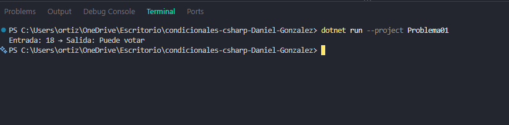

# Problema 01. Registro electoral

**Estructura elegida:** Condicional `if-else`

**Justificación:** Permite evaluar una condición booleana simple (si la edad es mayor o igual a 16) para bifurcar el flujo del programa en dos caminos posibles.

**Evidencia:**
