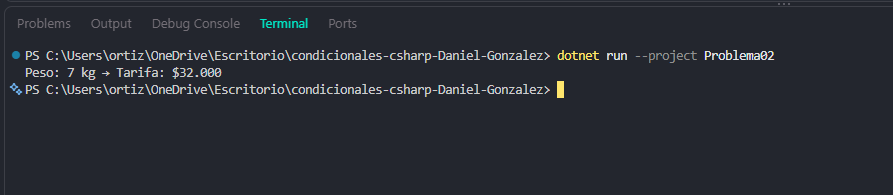

# Problema 02. Tarifa de envío por peso

**Estructura elegida:** Condicionales anidados (if-else if)

**Justificación:** Facilita la evaluación secuencial de múltiples rangos numéricos excluyentes.

**Evidencia:**

