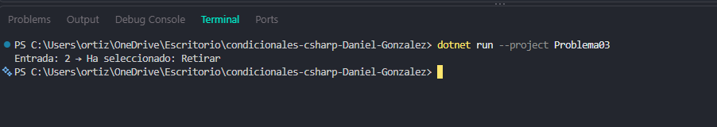

# Problema 03. Menú de cajero automático

**Estructura elegida:** Estructura switch tradicional

**Justificación:** Ideal para evaluar opciones discretas o menús de opciones numéricas.

**Evidencia:**

