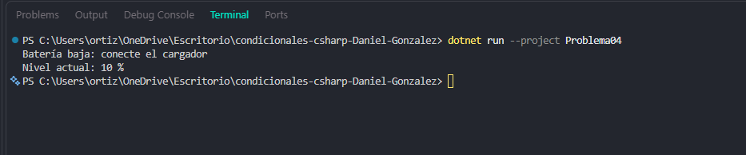

# Problema 04. Alerta de batería

**Estructura elegida:** Condicional simple if

**Justificación:** Permite ejecutar una acción opcional bajo una alerta sin alterar el flujo principal.

**Evidencia:**

