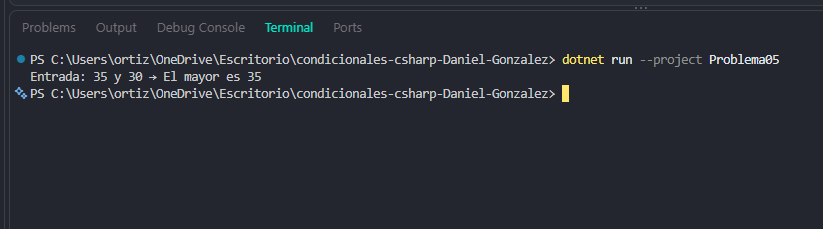

# Problema 05. El mayor de dos números

**Estructura elegida:** Operador ternario

**Justificación:** Optimiza la asignación condicional en una sola línea de código limpia y legible.

**Evidencia:**

