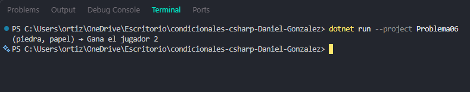

# Problema 06. Piedra, papel o tijera

**Estructura elegida:** Switch Expression (switch)

**Justificación:** Permite hacer pattern matching sobre tuplas para evaluar múltiples combinaciones simultáneamente.

**Evidencia:**

