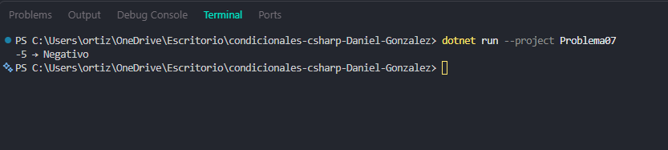

# Problema 07. Signo de un número

**Estructura elegida:** Operador ternario anidado

**Justificación:** Evalúa en cadena si un número es positivo, negativo o cero de manera compacta.

**Evidencia:**

