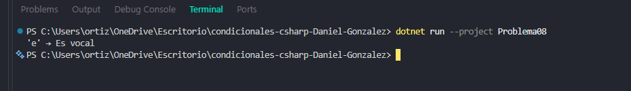

# Problema 08. Vocal o consonante

**Estructura elegida:** Condicionales anidados (if-else)

**Justificación:** Valida primero si el carácter es una letra y posteriormente clasifica su tipo.

**Evidencia:**

