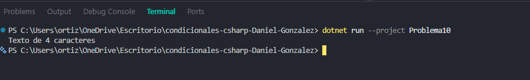

# Problema 10. Analizador de datos recibidos

**Estructura elegida:** Pattern Matching con switch

**Justificación:** Identifica dinámicamente el tipo de dato subyacente de un objeto de forma segura.

**Evidencia:**

