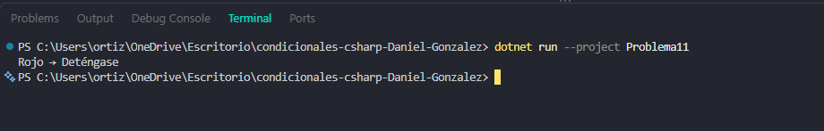

# Problema 11. Semáforo inteligente

**Estructura elegida:** Enumeraciones (enum) y switch

**Justificación:** Estructura estados fijos del sistema mejorando la legibilidad y el mantenimiento.

**Evidencia:**

