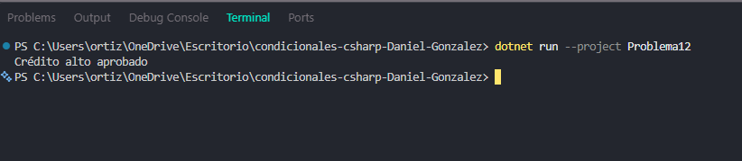

# Problema 12. Aprobación de crédito

**Estructura elegida:** Condicionales anidados (if-else)

**Justificación:** Valida restricciones jerárquicas (primero empleo, luego ingresos).

**Evidencia:**

