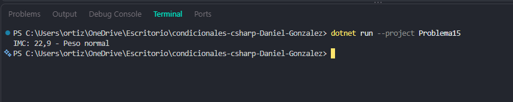

# Problema 15. Índice de masa corporal

**Estructura elegida:** Switch Expression con rangos

**Justificación:** Clasifica el resultado numérico del IMC evaluando rangos continuos limpios.

**Evidencia:**

