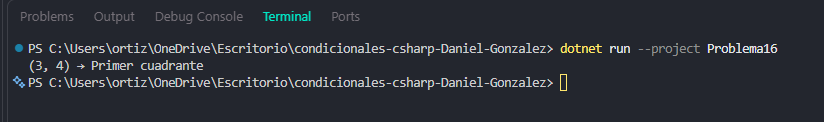

# Problema 16. Ubicación de un dron

**Estructura elegida:** Pattern Matching de tuplas

**Justificación:** Determina la posición cartesiana evaluando coordenadas X e Y en paralelo.

**Evidencia:**

