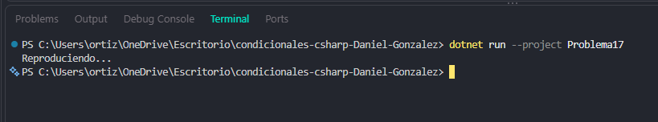

# Problema 17. Control de un reproductor

**Estructura elegida:** Switch Expression (switch)

**Justificación:** Ejecuta respuestas textuales basadas en comandos de control recibidos.

**Evidencia:**

