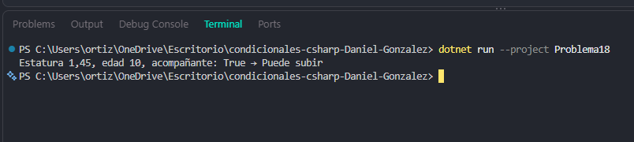

# Problema 18. Montaña rusa

**Estructura elegida:** Expresión booleana compuesta

**Justificación:** Combina reglas de estatura, edad y compañía mediante lógica booleana avanzada.

**Evidencia:**

