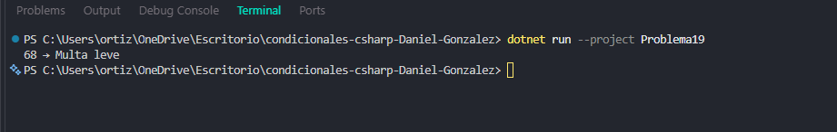

# Problema 19. Radar de velocidad

**Estructura elegida:** Switch Expression con rangos

**Justificación:** Clasifica infracciones de tránsito evaluando tramos numéricos de velocidad.

**Evidencia:**

