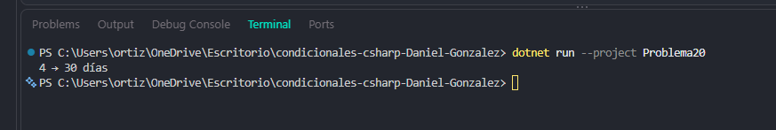

# Problema 20. Días de cada mes

**Estructura elegida:** Switch Expression con agrupación

**Justificación:** Agrupa múltiples casos que comparten un mismo resultado usando el operador or.

**Evidencia:**

