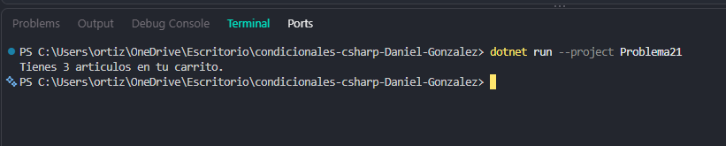

# Problema 21. Carrito de compras

**Estructura elegida:** Operador ternario en string

**Justificación:** Inserta dinámicamente el sufijo singular o plural dentro de la interpolación.

**Evidencia:**

