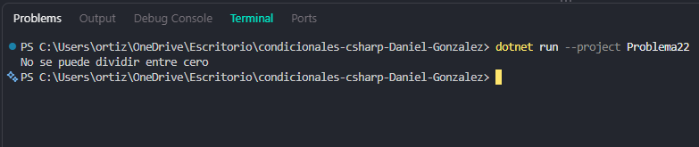

# Problema 22. Calculadora básica

**Estructura elegida:** Condicionales anidados (`if - else if - else`)

**Justificación:** Permite evaluar de forma secuencial el operador aritmético recibido e incluir una validación específica para evitar la división entre cero antes de realizar el cálculo.

**Evidencia:**
