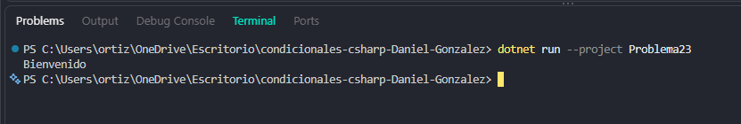

# Problema 23. Inicio de sesión

**Estructura elegida:** Condicionales anidados (if-else)

**Justificación:** Valida de forma independiente la existencia del usuario y la seguridad de su contraseña.

**Evidencia:**

